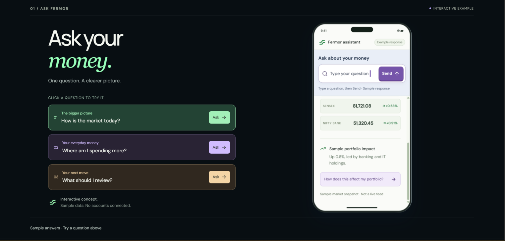
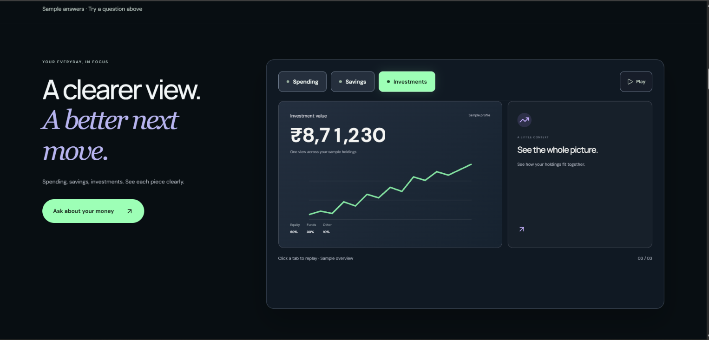
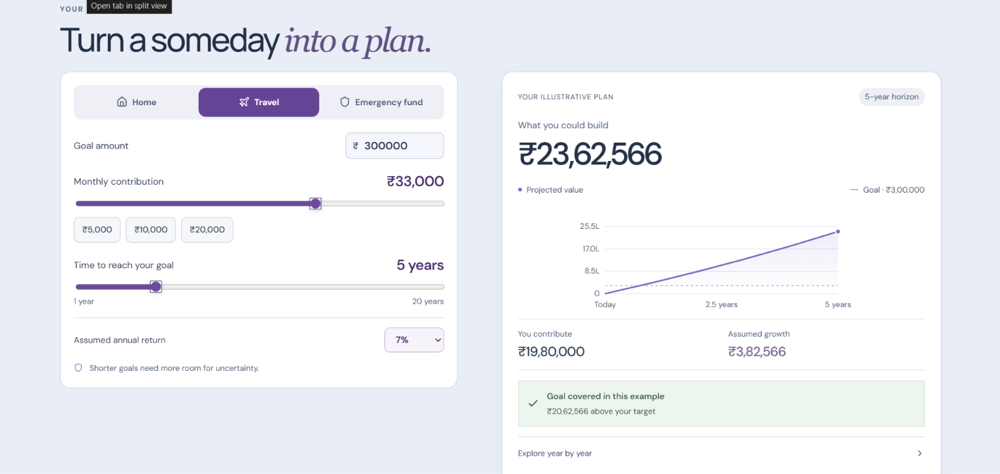
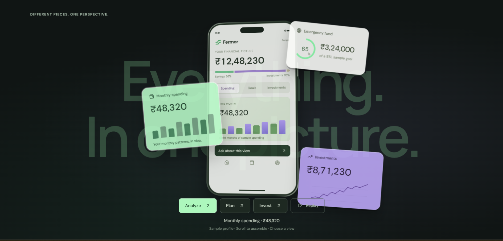
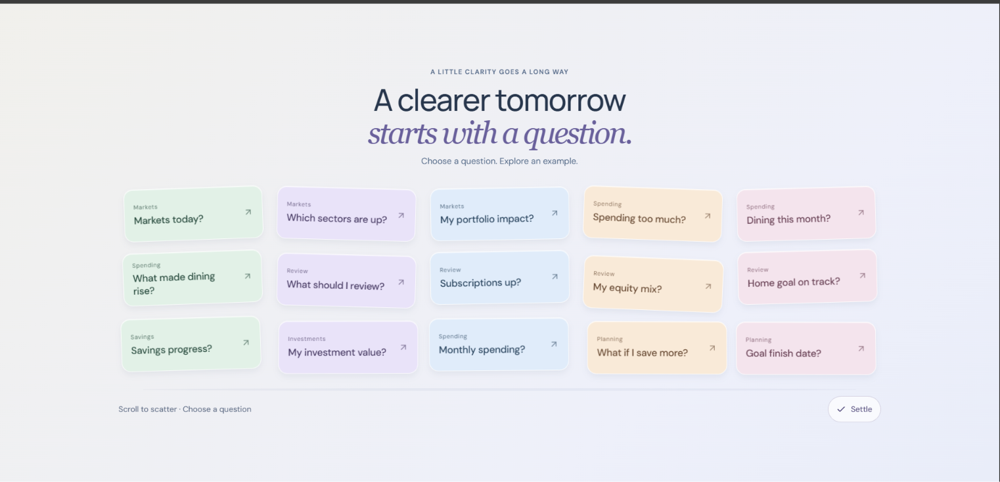
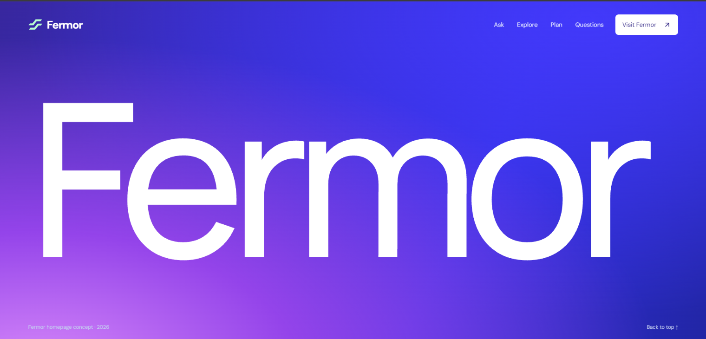

# fermor-homepage
An interactive fintech homepage concept for Fermor, featuring scroll-driven storytelling, 3D device animations, financial insights, an AI assistant demo, an investment explorer and a dynamic goal planner. Built with Next.js, React, TypeScript, Three.js and CSS.
# Fermor — Your money, in perspective

A responsive homepage concept for Fermor. It presents a path from asking a money question to understanding the answer, seeing the wider picture, and planning a next move.

## Built with

Next.js 16, React 19, TypeScript, CSS, SVG, and Three.js. Device interfaces are rendered as HTML and CSS so the content remains readable and responsive.

## Run locally

Requires Node.js 22.13 or newer.

```bash
git clone https://github.com/SyedAdam28/fermor-homepage.git
cd fermor-homepage
npm install
npm run dev
```

Open [http://localhost:3000](http://localhost:3000). For a production build:

```bash
npm run build
npm start
```

No environment variables or external API keys are required.

## What to explore

- Scroll from the opening phone into the assistant experience.
- Choose a suggested question or type in the composer to see a prepared example response.
- Switch spending, savings, and investment views; explore their changing figures and charts.
- Adjust goal-planning inputs to see the illustrative projection update.
- Scroll through the assembled overview, flipping story cards, and falling questions. Selecting a question shows an answer in the same section.

## Screenshots

These screenshots show the homepage concept. The deployed site is the best place to experience its motion and interactions.

| Assistant | Insights |
| --- | --- |
|  |  |

| Planner | Overview |
| --- | --- |
|  |  |

| Questions | Closing scene |
| --- | --- |
|  |  |

## Design decisions

The homepage leads with a question because finance often begins with uncertainty. The assistant, insights, explorer, and planner each give the visitor a more concrete next step. Light planning surfaces balance the darker analytical sections, while restrained depth and scroll motion make the product story tangible. The layout adapts to compact screens and supports reduced-motion preferences.

## Scope of the demo

This is an interactive frontend demonstration. It does **not** connect to financial accounts, retrieve live market prices, or call an AI service. Questions use prepared example responses; balances, charts, and market-like figures are illustrative. Goal projections are calculations based on chosen assumptions and exclude taxes, fees, and inflation. They are not financial advice.

## Deployment

Import this public repository into Vercel with the **Next.js** preset and the repository root (`./`). The build script is `npm run build`. Open the production URL on desktop and mobile to review the final experience.
